<div align="center">

# SimQ: Simulation Queue

**Queue, check, run and watch your simulations on a Linux workstation.**

[](https://github.com/HirushaW/Simulation-Queue/actions/workflows/ci.yml)


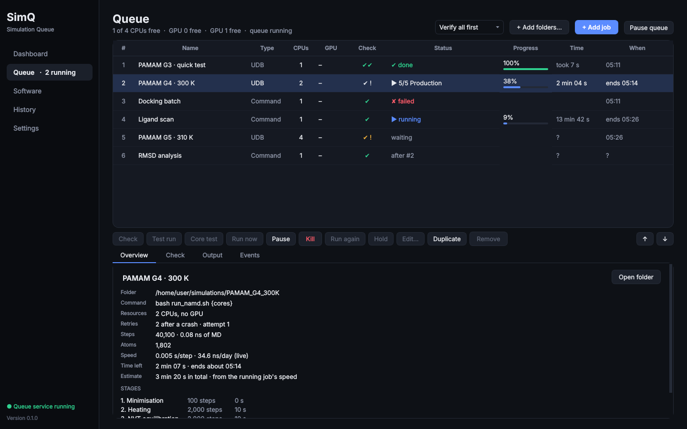

</div>

SimQ is a desktop app for people who run molecular dynamics and other long
simulations on their own workstation. You give it a list of simulation folders.
It checks each one, runs them one after another (several at once when there
are free CPUs), shows how far each has got and when it will finish, restarts
the ones that crash, and tells you when it is done. It works with any program
you can start from a terminal, and knows NAMD, AMBER and UDB packages in detail.

---

## Contents

1. [Why SimQ?](#1-why-simq)
2. [A tour of the app](#2-a-tour-of-the-app)
3. [The ideas behind it, in plain words](#3-the-ideas-behind-it-in-plain-words)
4. [Installation](#4-installation)
5. [Your first queue, step by step](#5-your-first-queue-step-by-step)
6. [How SimQ works](#6-how-simq-works)
7. [What SimQ knows about NAMD, AMBER and UDB](#7-what-simq-knows-about-namd-amber-and-udb)
8. [Notifications and automatic start](#8-notifications-and-automatic-start)
9. [Command line](#9-command-line)
10. [Files SimQ creates](#10-files-simq-creates)
11. [Questions and troubleshooting](#11-questions-and-troubleshooting)
12. [For developers](#12-for-developers)
13. [Status and limitations](#13-status-and-limitations)

---

## 1. Why SimQ?

A typical week of molecular dynamics on a workstation looks like this: five
systems to simulate, each taking one to three days. You start one in a terminal,
check on it now and then, and start the next one when it finishes. If it ends
at 3 a.m., the machine sits idle until morning. If it crashes in the
equilibration stage, you find out the next day. And a 150 GB trajectory can
quietly fill the disk halfway through.

SimQ takes this over:

| Without SimQ | With SimQ |
|---|---|
| Start each run by hand, one at a time | Add all of them once; the next starts the moment one finishes |
| The machine idles between runs | Jobs start straight away, day or night |
| Small jobs wait behind big ones | Small jobs run next to big ones on free CPUs, without slowing the big one |
| A typo or missing file shows up hours in | A 2-second check finds it before the job starts |
| "How long will this take?" is a guess | Measured speed, a finish time for every job and for the whole queue |
| A crash at 3 a.m. wastes the night | The job is restarted from its last restart files, and you get an email |
| The disk fills up mid-run | SimQ checks the space first, and pauses jobs before the disk is full |

## 2. A tour of the app

SimQ is one window with five pages. *These screenshots were taken in demo mode,
with simulated GPUs and a fake NAMD standing in for the real ones.*

### Queue


The main page. Each row is a job, and the columns show its state:

| Column | What it shows |
|---|---|
| **Check** | `–` not checked yet · `✔` check passed · `✔ !` passed, with warnings · `✔✔` test run passed · `✘` a problem was found |
| **Status** | `waiting` · `▶` running, with the current stage (e.g. *5/5 Production*) · `⏸` paused · `✔ done` · `✘ failed` · *on hold* · *after #2* |
| **Progress** | how far the job has got, read from the simulation's own log |
| **Time** | time left for a running job; expected run time for a waiting one |
| **When** | when a waiting job should start and end; when a running one should end |

The buttons under the table act on the selected job. Below them, four tabs show
its details: **Overview** (folder, command, stages, speed, estimate), **Check**
(every finding of the check), **Output** (the live log) and **Events** (its history).

| Check results | Live output | A failed job explained |
|---|---|---|
| 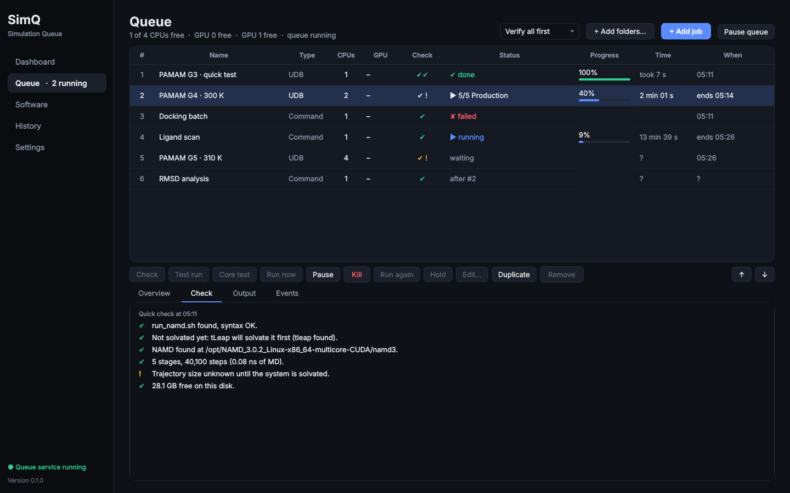 | 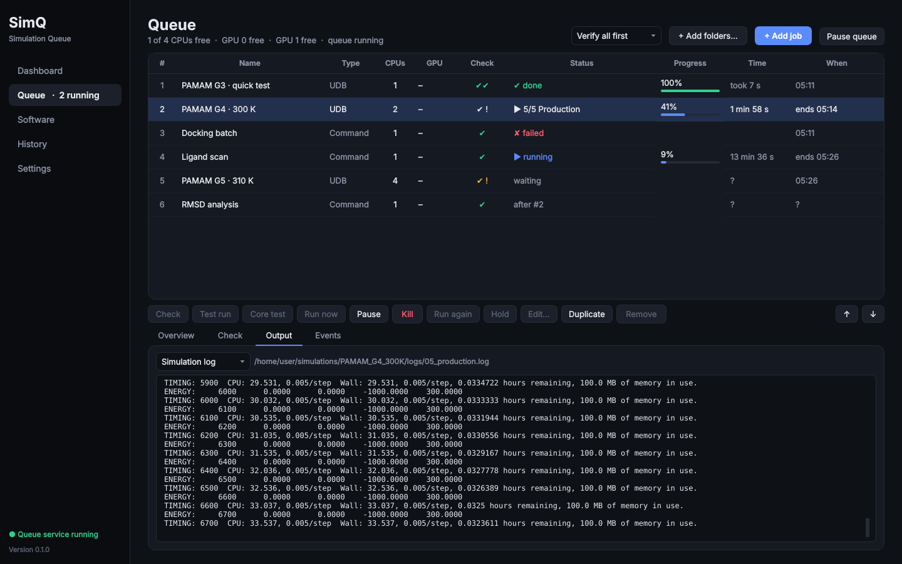 | 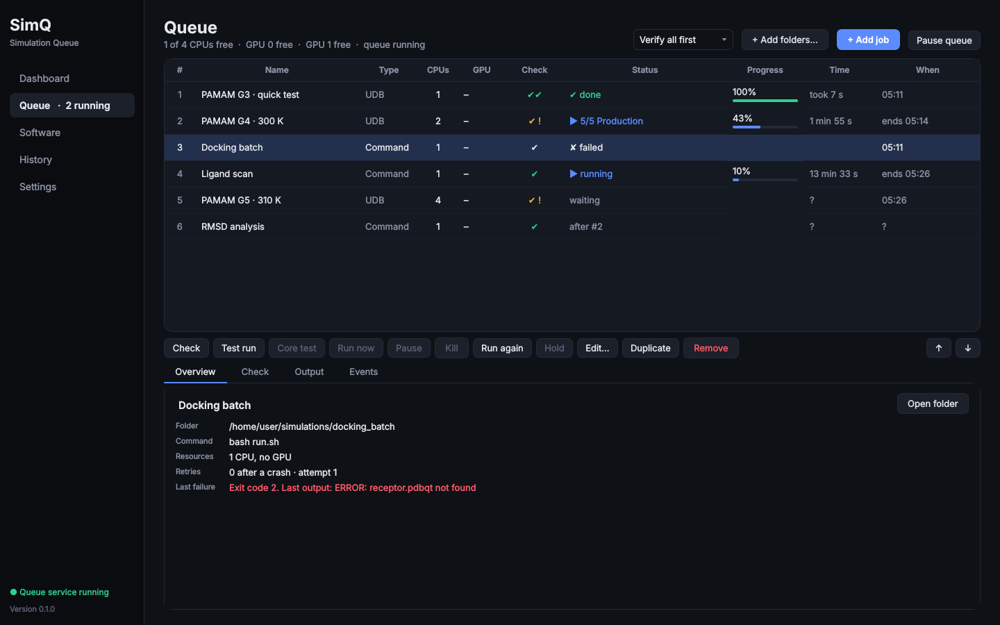 |

### Adding a job

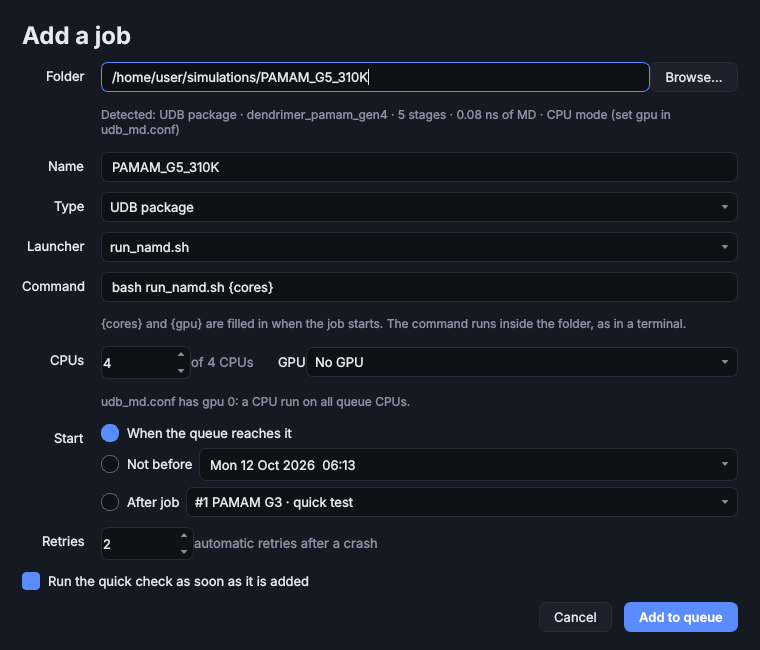

Choose a folder. SimQ looks inside and works out what it is: a UDB package, a
NAMD configuration, an AMBER input or a shell script. It then fills in the
command, the CPUs and the GPU, and explains its choice. You can change
anything. **+ Add folders…** adds a whole folder of simulations at once.

### Dashboard

| Processor, memory and running jobs | GPUs and disks |
|---|---|
| 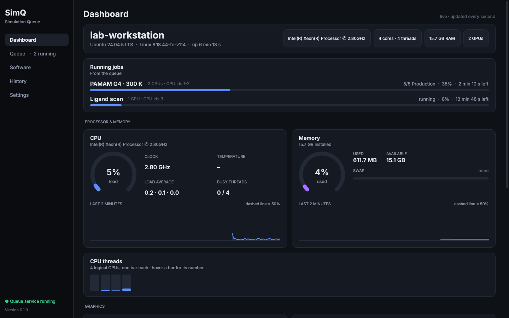 | 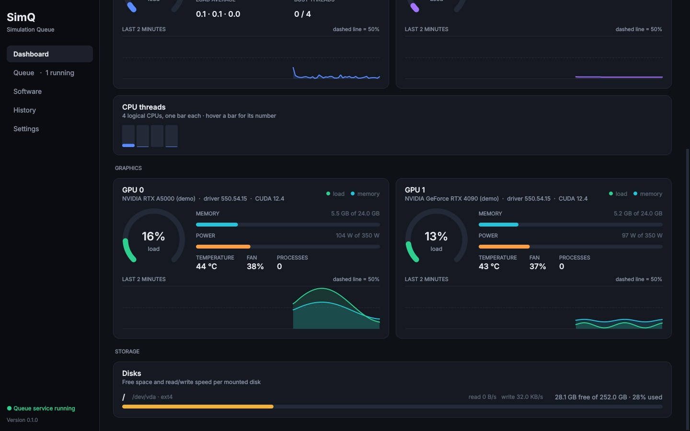 |

A live view of the machine, updated every second:
- every CPU thread and memory;
- every NVIDIA GPU (load, memory, temperature, power, fan);
- every disk (free space, read and write speed);
- the jobs running now and which CPUs and GPU each one holds.

### Software

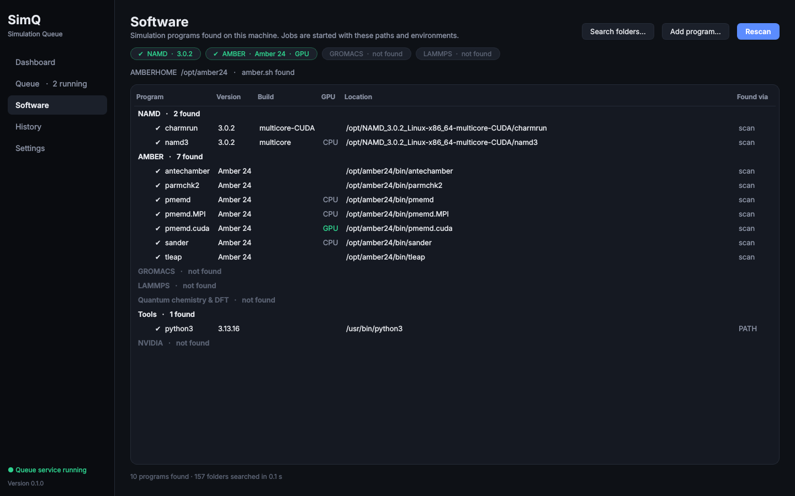

SimQ searches the machine for simulation programs: NAMD, AMBER (and `amber.sh`),
GROMACS, LAMMPS, ORCA, Gaussian, CP2K, Quantum ESPRESSO, VASP, VMD and others.
It shows each one's version and whether it is a GPU build. It looks in the
usual places (`PATH`, `/opt`, `/usr/local`, your home folder), so an unpacked
`~/NAMD_3.0.2_Linux-x86_64-multicore-CUDA` is found with no setup.

### History and Settings

| History | Settings |
|---|---|
| 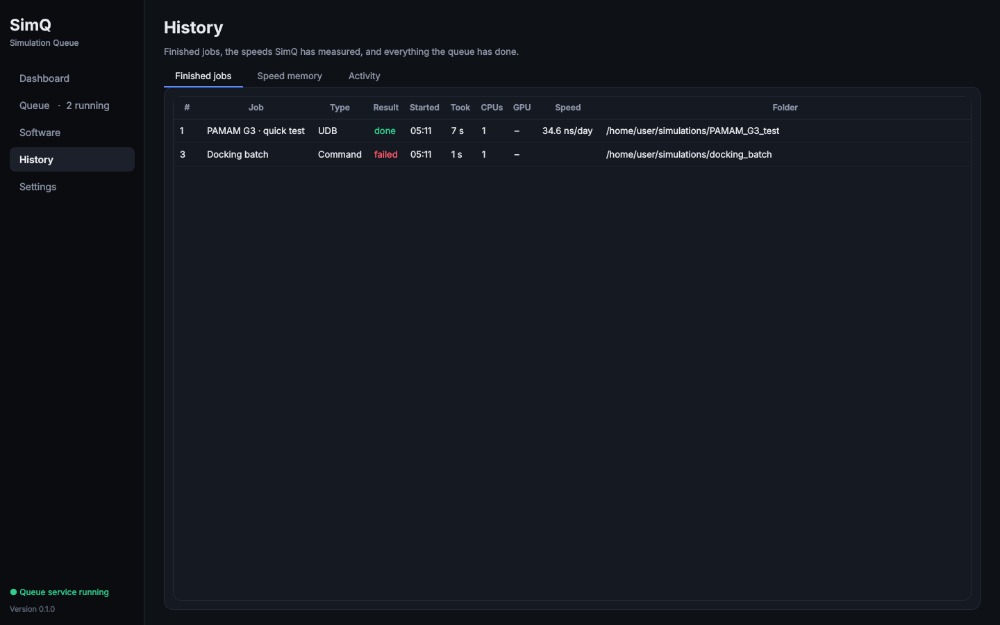 | 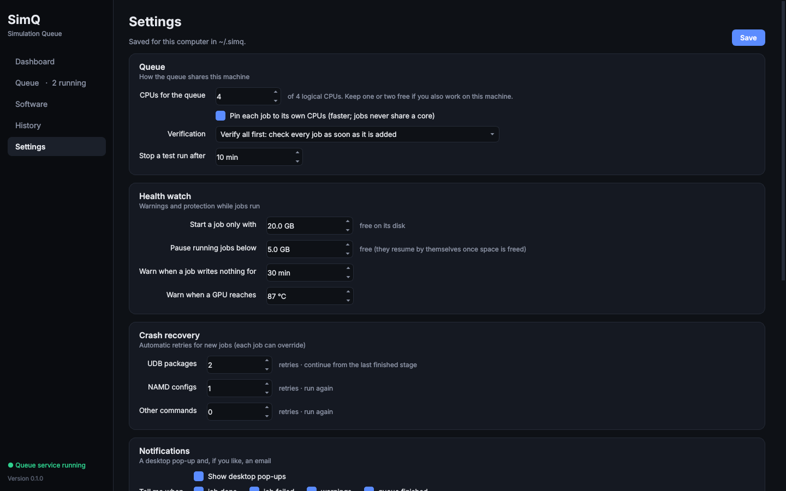 |

**History** lists finished jobs, the *speed memory* (every speed SimQ has
measured) and a log of everything the queue did. **Settings** holds how many
CPUs the queue may use, the safety limits, crash recovery, notifications and
automatic start.

## 3. The ideas behind it, in plain words

**Job:** one simulation to run. A job is a folder plus the command you would
type in a terminal inside that folder, e.g. `bash run_namd.sh 16`.

**Queue:** the ordered list of jobs. **▶ Start queue** lets jobs start, and
**Pause queue** stops new ones from starting while running jobs carry on.

**Queue service:** a small background program that does the actual work. It
starts jobs, watches them and restarts them after a crash. It keeps running
when you close the window, so **closing SimQ never stops your simulations**.

**CPUs:** each job asks for a number of CPUs (more precisely, *logical CPUs*
or hardware threads). SimQ gives each job its own CPUs and *pins* the job to
them, so two jobs never compete for the same core. In a command, `{cores}`
becomes that number.

**GPU:** a job can ask for no GPU, any free GPU, or a specific one. Each GPU
runs one job at a time. SimQ hands the job its GPU through
`CUDA_VISIBLE_DEVICES`, so a script that says `+devices 0` runs on whichever
GPU it was given.

**Check (✔):** a quick look (about 2 seconds) at everything that can be verified
without running: the folder exists, the programs are installed, the scripts
have no syntax errors, the input files exist, how many steps it will run, and
whether the trajectory will fit on the disk. A job is checked again just
before it starts, because folders get moved.

**Test run (✔✔):** your real pipeline, shrunk to a few thousand steps, run in a
scratch copy of the folder. It proves that the whole chain works (tLeap,
every stage hand-over, the GPU) and measures the real speed. It takes a few
minutes, and your folder is never touched.

**Estimate:** how long a job will take, from the speed measured by its test
run, from a similar earlier job (the *speed memory*), or, once it runs, from its
own log.

**Backfilling:** if the next job needs 48 CPUs and only 16 are free, a smaller
job further down may start on those 16, but only if it cannot delay the big
job.

**Crash recovery:** a crashed job is started again. A NAMD pipeline continues
from its last finished stage instead of starting over.

## 4. Installation

SimQ needs **Linux** and **Python 3.10 or newer** (Ubuntu 22.04 and later have it).

```bash
# 1. System packages (Ubuntu/Debian). The second one lets Qt open windows on X11.
sudo apt install python3-venv libxcb-cursor0

# 2. Download SimQ
git clone https://github.com/HirushaW/Simulation-Queue.git
cd Simulation-Queue

# 3. Make a private Python environment for it, and install SimQ there
python3 -m venv .venv
source .venv/bin/activate
pip install -e .

# 4. Start it
simq
```

To start it again later, open a terminal and run:

```bash
cd Simulation-Queue && source .venv/bin/activate && simq
```

> **What is `.venv`?** A self-contained folder with Python and SimQ's libraries
> (Qt, psutil …), so SimQ cannot conflict with anything else on the machine.
> Delete the folder and SimQ is gone.

To update SimQ later: `git pull` inside the folder, then `pip install -e .` again.

## 5. Your first queue, step by step

### Example A: a UDB package (NAMD)

1. Open SimQ (`simq`) and look at the **Software** page. `namd3` and `tleap`
   should have a ✔. If not, use **Search folders…** to point SimQ at them.
2. On the **Queue** page press **+ Add job** and choose the package folder
   (the one with `udb_md.conf` and `run_namd.sh`).
3. SimQ recognises it: *"UDB package · 5 stages · 100.7 ns of MD · CPU mode"*.
   It picks `run_namd.sh`, sets the command `bash run_namd.sh {cores}`, and
   suggests CPUs and a GPU from the `set gpu` line in `udb_md.conf`.
   Press **Add to queue**.
4. The job is checked straight away. Open its **Check** tab to read the findings.
5. Press **Test run**. A few minutes later the job shows **✔✔**, and **Time**
   shows how long the real run will take.
6. Press **▶ Start queue.**

While it runs, the job shows its stage (*3/5 NVT equilibration*), its progress and
its finish time. The **Output** tab shows the NAMD log as it is written.

### Example B: any other command

1. **+ Add job**, choose the folder.
2. Type the command exactly as you would in a terminal inside that folder, e.g.
   `python3 analyse.py --threads {cores}` or `bash run_gromacs.sh`.
3. Set the CPUs and GPU it needs. Optionally type your own estimate in hours,
   so SimQ can plan around it.

### Useful extras

- **After job:** start a job only when another has finished (e.g. analysis
  after production).
- **Not before:** start a job at a set time (e.g. tonight at 22:00).
- **Run now:** start a job straight away, even while the queue is paused.
- **Core test:** run short tests at, say, 8, 16, 32 and 48 CPUs. SimQ shows the
  speed at each, and suggests the smallest count that gets 90% of the best
  speed, so the remaining CPUs can run another job.

## 6. How SimQ works

### The parts

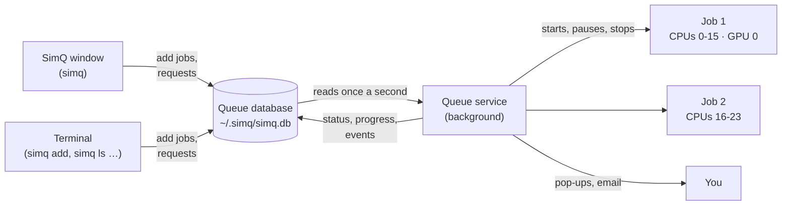

- The **window** and the **terminal commands** only read and write the queue
  database. When you press *Kill*, they add a request to it.
- The **queue service** is the only part that starts or signals simulations.
  Once a second it reads new requests, checks on running jobs, reads their
  progress, watches their health and starts whatever fits on the free CPUs and GPUs.
- Each job runs in its own *process group*, a little apart from SimQ. If the
  service is restarted, or the computer goes down, SimQ finds out what happened
  to every job the next time it starts.

### The life of a job

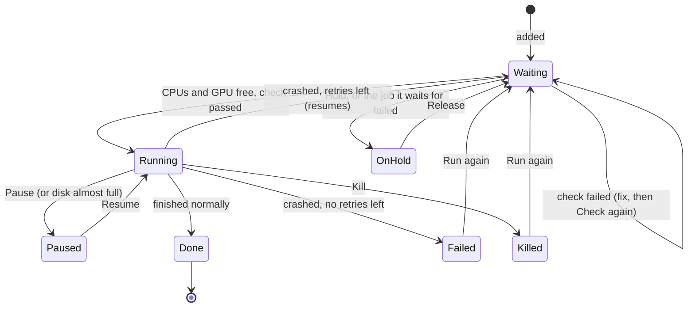

### How jobs share the machine

Jobs start **in queue order** while their CPUs and GPU are free. When the job
at the front does not fit, SimQ works out when it *will* fit, from the estimates of
the jobs running now, and lets a smaller job go first only if that cannot
delay it. This rule is known as *EASY backfilling*, and HPC batch schedulers
use the same idea.

> **Example on a 64-CPU machine with one GPU.** Job A (48 CPUs + GPU) is running
> and will end in 10 hours. Next in line is job B, which needs 48 CPUs, so it must
> wait for A. Job C needs 8 CPUs and has no estimate. Once A ends, B takes 48 of
> the 64 CPUs and 16 stay spare, so C can safely use 8 of them now. C starts
> straight away; B still starts the moment A finishes.

Every job is pinned with `taskset` to its own CPUs, physical cores first, then
hyperthreads. It also gets these variables:

| Variable | Value |
|---|---|
| `CUDA_VISIBLE_DEVICES` | the GPU it was given (`CUDA_DEVICE_ORDER=PCI_BUS_ID`, so numbers match `nvidia-smi`) |
| `SIMQ_CORES`, `OMP_NUM_THREADS` | its CPU count |
| `NCORES` | its CPU count (UDB jobs, read by `run_full.sh`) |
| `SIMQ_JOB_ID`, `SIMQ_RUN_ID` | which job and run this is |

If AmberTools was found, `amber.sh` is sourced first, so `tleap` works inside jobs.

### Time estimates

| Source | When it is used |
|---|---|
| **The job's own log** | while it runs: NAMD `TIMING` lines, AMBER `mdinfo` |
| **Its test run** | after **Test run** |
| **Speed memory** | a finished job or test of the same program, mode (CPU/GPU) and similar size, scaled to this job's atoms and CPUs |
| **Your estimate** | hours you typed for a generic command |

Combining these with the queue rules gives a predicted start and end for every
waiting job, and *"everything done by …"* at the top of the page.

### Safety

- **Disk:** a job does not start unless its disk has enough free space
  (default 20 GB) *and* room for its expected trajectory. If a disk drops below
  5 GB while jobs write to it, those jobs are paused, and they resume by
  themselves once you free some space.
- **Stalled job:** a warning when a job writes nothing for 30 minutes.
- **NaN energies:** a warning when NAMD or AMBER energies turn into NaN. That
  usually means the system has blown up.
- **GPU temperature:** a warning above 87 °C.
- **Crashes:** see the next section. All limits can be changed in Settings.

## 7. What SimQ knows about NAMD, AMBER and UDB

| Type | Recognised by | Steps read from | Progress read from |
|---|---|---|---|
| **UDB package** | `udb_md.conf` and `run_namd.sh` / `run_full.sh` | every stage file, via `udb_md.conf` | the stage logs (`logs/0X_*.log`) |
| **NAMD config** | a `.conf` / `.namd` file | the config itself | NAMD's `TIMING` and `ENERGY` lines |
| **AMBER** | `pmemd*` / `sander` with an `&cntrl` mdin | `nstlim`, `maxcyc`, `dt` | `mdinfo` |
| **Any command** | anything else | (none) | elapsed time against your estimate |

**Reading NAMD configs exactly.** NAMD configuration files are Tcl scripts:
they use variables, `source udb_md.conf`, procedures like `udb_mult`, `if`
blocks and loops (the heating ramp is 20 `run` commands in a loop). SimQ
includes a small Tcl interpreter that runs the configuration with `run` and
`minimize` replaced by counters. That gives the exact step count of every
stage, with no NAMD or system Tcl needed.

**Crash recovery for UDB packages.** When a UDB job is retried, SimQ looks at
which stages finished (NAMD writes `<stage>.coor` only at the end of a stage):

| Situation | What SimQ does |
|---|---|
| Production was interrupted | `bash run_namd.sh restart N`, which continues from the production restart files |
| An earlier stage was interrupted | Moves that stage's partial restart files aside (`*.simq-interrupted-<time>`) and runs `run_namd.sh` again, so the stage is redone from its start and finished stages are skipped |
| `run_full.sh`, phase 2 interrupted | `bash run_full.sh resume` |

The second row matters: `run_namd.sh` treats restart files as "stage
finished", so without this step it would skip a half-finished stage.
[`docs/UDB_NOTES.md`](docs/UDB_NOTES.md) lists this and other suggestions for
the UDB scripts.

**Other programs** (GROMACS, LAMMPS, ORCA, Gaussian, CP2K …) run as
*Any command* jobs. They get the queue, CPU pinning, GPU assignment, crash
retries and notifications, but no step-level progress.

## 8. Notifications and automatic start

**Notifications** (Settings → Notifications): desktop pop-ups, and optionally
email, when a job finishes, fails, or needs attention, and when the queue is empty.

For **Gmail**:
- server `smtp.gmail.com`, port `587`, STARTTLS;
- your address as the username;
- an **App Password** as the password (Google Account → Security → 2-Step
  Verification → App passwords). Your normal password will not work.

Press **Send a test email** to check it. The password is stored only on your
computer, in a file only you can read.

**Automatic start** (Settings → Queue service): installs a *systemd user
service*, so the queue keeps going after a reboot even if you never open
SimQ. To have it start at boot before anyone logs in, also run once:

```bash
sudo loginctl enable-linger $USER
```

## 9. Command line

Everything also works from a terminal, which is handy over SSH:

| Command | What it does |
|---|---|
| `simq` | open the window |
| `simq add FOLDER [--cores N] [--gpu none\|auto\|0] [--command "…"] [--after JOB] [--at 22:00] [--hours H]` | add a job (type and command are detected) |
| `simq ls` | show the queue |
| `simq queue start` / `simq queue pause` | start or pause the queue |
| `simq check JOB` / `simq test JOB` / `simq corescan JOB` | quick check · test run · core-count test |
| `simq run-now JOB` | start a job now, even if the queue is paused |
| `simq pause JOB` / `simq resume JOB` / `simq kill JOB` | control a running job |
| `simq retry JOB` | queue a failed or killed job again (UDB jobs continue where they stopped) |
| `simq hold JOB` / `simq release JOB` / `simq remove JOB` | manage waiting jobs |
| `simq log JOB` | a job's events and the end of its output |
| `simq service start\|stop\|status` | the background service |
| `simq info` / `simq detect` | this machine's hardware · installed simulation software |

For example, on a 64-CPU workstation:

```text
$ simq ls
Queue running · service running · 64 CPUs for the queue
#  Name            Type     CPUs  GPU  Check  Status                   Progress  Time        When
1  PAMAM G4 300 K  UDB      2     any  ✔✔     ▶ 4/5 NPT equilibration  24%       31 h 10 min ends Wed 09:12
2  PAMAM G5 310 K  UDB      48    –    ✔      waiting                            3 d 4 h     Wed 09:12 → Sat 13:40
```

## 10. Files SimQ creates

SimQ never changes your simulation folders, with one exception: moving the
partial restart files of an interrupted UDB stage aside, as described in
section 7. Its own files are in `~/.simq/`:

| Path | Contents |
|---|---|
| `simq.db` | the queue, settings and speed memory (readable only by you) |
| `runs/<id>/` | one folder per run: the command, the generated launch script `run.sh`, the output `output.log` and the exit code |
| `scratch/` | temporary copies used by test runs (deleted afterwards; kept if a test fails, so you can look) |
| `service.log` | messages from the queue service |
| `software.json`, `config.json` | software scan results and extra search folders |

## 11. Questions and troubleshooting

**Does closing the window stop my simulations?** No. Only *Kill* stops a job.

**What happens if the computer restarts during a run?** The job is counted as
crashed. With retries left, it is started again when SimQ's service starts
(automatically, if *automatic start* is on). UDB jobs continue from their last
finished stage.

**Can I still start simulations by hand in a terminal?** Yes, but SimQ does not
know about them, and may give their CPUs to a queued job. Lower *CPUs for the
queue* in Settings to keep some CPUs for yourself.

**Does SimQ support SLURM / clusters?** No. It is for a single workstation.

| Problem | Fix |
|---|---|
| `Could not load the Qt platform plugin "xcb"` | `sudo apt install libxcb-cursor0` |
| `libEGL.so.1: cannot open shared object file` | `sudo apt install libegl1` |
| The sidebar says *Queue service stopped* | Press **Start service**, or run `simq service start`. See `~/.simq/service.log` |
| A check says a program was not found | Software → **Search folders…** or **Add program…** |
| *No NVIDIA GPU detected* | Make sure `nvidia-smi` works in a terminal |
| `no graphical display found` | Run SimQ on the workstation's desktop or with `ssh -X`, or use the `simq` terminal commands |

## 12. For developers

```bash
pip install -e ".[dev]"
ruff check . && ruff format --check .      # style
QT_QPA_PLATFORM=offscreen pytest            # 98 tests
```

```text
simq/
├── engine/      queue service, scheduler, launcher, checks, progress, test runs,
│                estimates, notifications, automatic start
├── analyze/     NAMD, AMBER and UDB readers; folder detection
├── tcl.py       the small Tcl interpreter for NAMD configs
├── db.py        the queue database
├── monitor/     CPU, memory, disks, GPUs
├── detect/      software detection
└── gui/         the window: dashboard, queue, software, history, settings
tests/           unit tests, and end-to-end tests that run the real UDB scripts
                 against fake namd3/tleap programs (tests/fakes/)
```

- [`docs/DESIGN.md`](docs/DESIGN.md): how SimQ is put together.
- [`CONTRIBUTING.md`](CONTRIBUTING.md): branches, pull requests and checks.
- [`CHANGELOG.md`](CHANGELOG.md): what changed in each version.

## 13. Status and limitations

**Version 0.1.0**, the first complete version.

- Fully tested in a build environment with simulated jobs. The tests drive
  the real UDB `run_namd.sh` / `run_full.sh` scripts against fake NAMD and
  tLeap programs that behave like the real ones, including crashes.
- **Not yet tested with real NAMD, AMBER or NVIDIA GPUs.** The first real runs
  on a workstation are the next step; please report anything odd.
- Linux only, one machine, one user.
- Live progress for NAMD, AMBER and UDB jobs; other programs show elapsed time.
